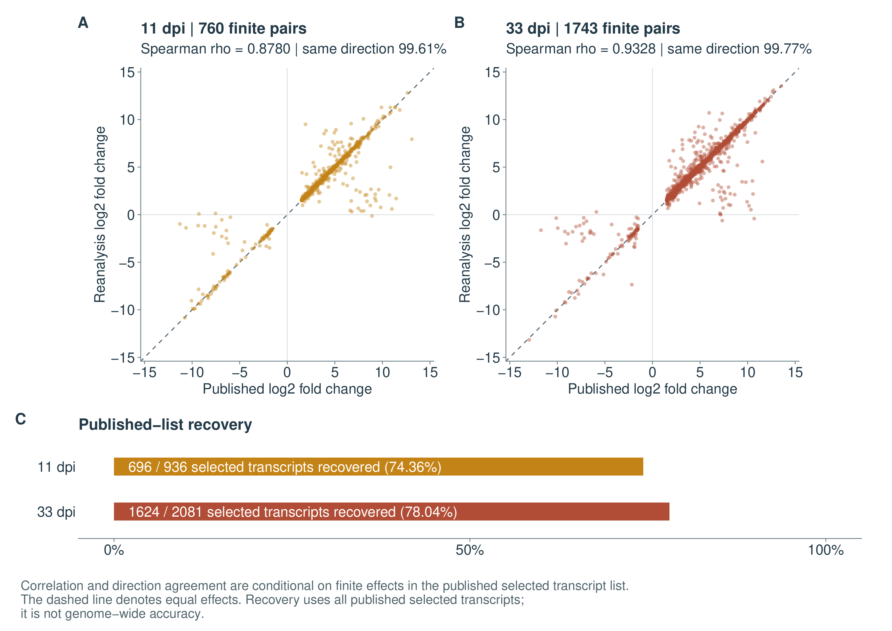

# RNA-seq reanalysis of Toxoplasma-infected mouse brain

Université Paris-Saclay, Master 2 workflow project | October 2026

This project reanalyses 12 public mouse-brain RNA-seq libraries from [Hu et al. (2020)](https://doi.org/10.3389/fmicb.2020.570903), archived under [PRJNA483261](https://www.ncbi.nlm.nih.gov/bioproject/PRJNA483261). It asks how closely a documented reanalysis recovers the published transcript lists and where the results differ. At each of 11 and 33 days after infection, three infected libraries are compared with three controls. I built the workflow and ran it on a virtual machine to make this comparison.

## Start here

- **Report:** [PDF](report/report.pdf) or [Markdown](report/report.md), covering the question, methods, results and limitations.
- **Main results:** [differential-expression counts](example-results/analysis/summary.tsv), [comparison with the published lists](example-results/comparison/summary.tsv) and [GO enrichment summary](example-results/enrichment/summary.tsv).
- **Reproduce the work:** [running guide](docs/RUNNING.md). [Technical details](report/supplementary_reproduction.md) link the source records, execution checks and figure instructions.

## Main results

| Analysis | 11 days | 33 days |
|---|---:|---:|
| Differential genes, up / down | 496 / 41 | 1,173 / 18 |
| Differential transcripts, up / down | 724 / 130 | 1,804 / 101 |
| Published selected transcripts recovered | 696 / 936 (74.36%) | 1,624 / 2,081 (78.04%) |

Primary results require BH-adjusted P < 0.05 and absolute unshrunken log2 fold change > 1.5. Gene and transcript results are kept separate. Recovery refers to the paper's selected transcript lists; it is not a measure of genome-wide accuracy.



Interferon, antigen-presentation and lymphocyte-related GO terms are enriched at both time points. The paper's selected downward GO categories were not recovered under this gene-level specification. Counting two overlapping annotation records together changed some individual GO results while preserving the six immune-related terms highlighted in the report.

## Methods and limits

A containerized Snakemake workflow runs read-quality checks, Salmon quantification, tximport/DESeq2 analysis, GO enrichment and comparison with the publication. It uses Ensembl release 100/GRCm38.p6. Archived read counts match the paper's clean-read counts, so additional trimming is disabled. The analysis settings, source records and complete saved result tables are included.

The observed unit is a reported biological library. The paper's pooling wording leaves one-mouse-to-one-library independence unresolved, and batch/cage information is unavailable. The two time points contain different animals. Whole-brain expression mixes cell populations, so the results do not distinguish infiltration from changes within cells. Local checks do not establish independent biological validation or a fresh full run on a second machine.

## Inspect or rerun

The included results can be checked with Python 3.9 or later, without downloading sequencing data or refitting models:

```bash
python3 scripts/check_example_results.py
```

A full workflow run uses Linux x86_64, Docker and Snakemake 9.27.1. It starts with two threads and one concurrent job; allow approximately 32 GB RAM and 200 GB disk. Follow the [running guide](docs/RUNNING.md) for setup and execution. Raw reads, references/indexes, full Salmon quantification, fitted R objects and the complete GO association snapshot are retrieved or generated by the workflow rather than stored in Git. New runs write to the separate, Git-ignored `results/` directory; the supplied snapshot is in `example-results/`.

The [diagnostic HTML appendix](example-results/report/index.html) and [MultiQC report](example-results/qc/multiqc_report.html) can be opened locally after downloading the repository, keeping their relative paths intact.

The original study and source terms are credited in [NOTICE.md](NOTICE.md); [LICENSE](LICENSE) covers this repository's original code. The [project timeline](docs/PROJECT_TIMELINE.md) distinguishes the research period from later execution and presentation records.
