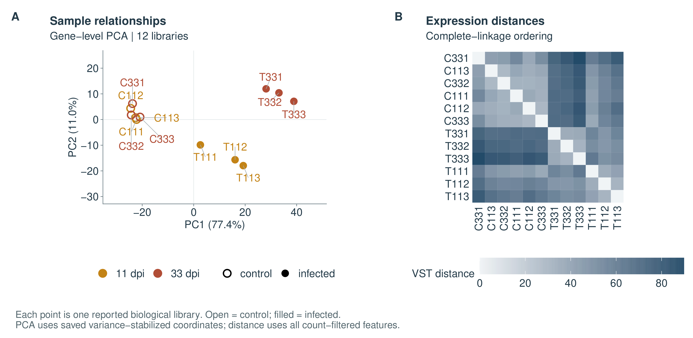
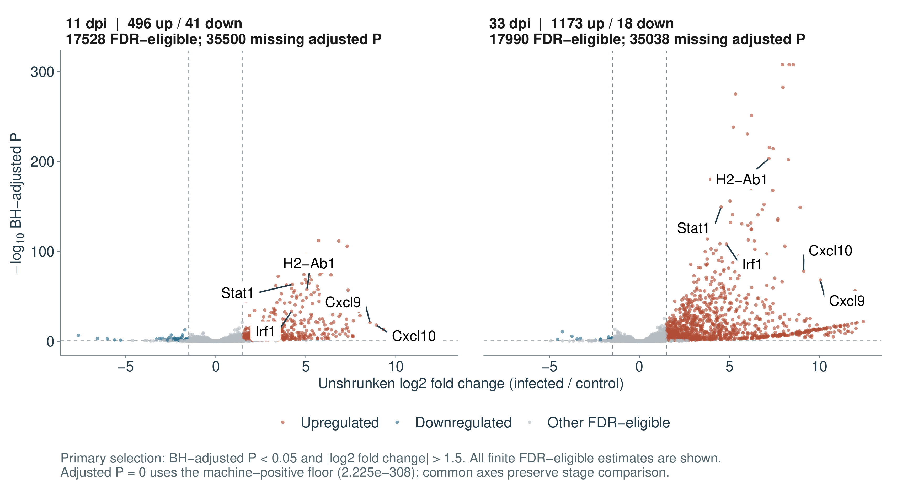
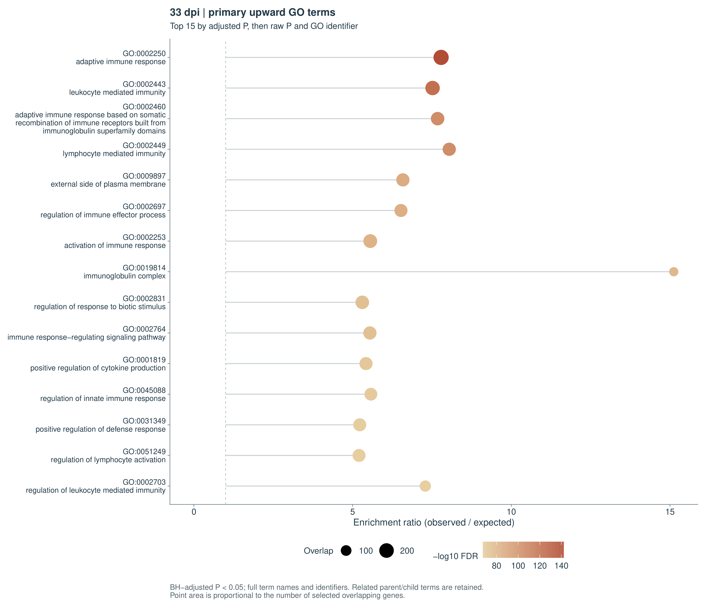
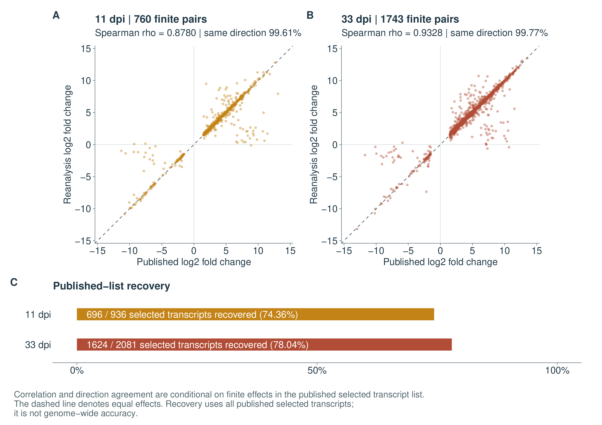

# Immune-response reconstruction and published-result agreement

The reconstructed mouse-brain transcriptome links an infection-associated immune response with measurable agreement to the selected transcript results of [Hu et al. (2020)](https://doi.org/10.3389/fmicb.2020.570903). The results below connect sample structure, gene-level programs and transcript-level comparisons. [Supplementary computational information](../report/supplementary_reproduction.md) and the [execution record](validation-status.md) document the supporting workflow.

## Sample structure and the retained cohort

All 24 paired FASTQ files were acquired from the frozen ENA URLs and checked against archive MD5 values and byte counts. The 12 libraries contain 409,862,759 read pairs; each Salmon processed-pair count equals its manifest count. All libraries infer an unstranded inward-facing paired layout (`IU`) and share the validated reference/index signatures. Host-transcript assignment ranges from 73.46% to 88.44%. All mates pass the FastQC per-base quality, N-content and adapter checks. Composition, GC and duplication flags are retained as diagnostics rather than treated as automatic trimming or deduplication instructions.

The Ensembl 100/GRCm38.p6 reconstruction contains 141,450 transcript targets, 53,028 gene identifiers and 66 primary-assembly decoys. Comprehensive annotation is needed to retain alternative-region targets present in the selected FASTA files. The selected file set and its coverage are documented in [reference-scope.md](reference-scope.md).

Gene-level all-sample PCA explains 77.4% and 11.0% of variation on its first two components. Controls cluster together; infected samples separate from controls, with an additional difference between infected time points. The coordinates summarize variance-stabilized counts.

T331 has the lowest host assignment (73.46%), but clusters with the other day-33 infected libraries. Its transformed-expression distances to T332/T333 are 35.89/37.26, compared with 69.91–75.47 to contemporaneous controls. The saved-model Cook diagnostics support retaining T331 in the declared cohort. T111 has a relatively weaker acute expression response and remains closest to an infected sample in the within-day diagnostics; the nearest-neighbour relationship varies with the feature set and analysis scope. All samples are retained.

## Shared and time-specific expression

Each day uses three infected and three control libraries in an independent `~ condition` model. The primary list requires BH-adjusted P < 0.05 and absolute unshrunken log2 fold change > 1.5. The effect cutoff filters a zero-effect Wald test; it is not a formal test that the effect exceeds 1.5. Gene-level import uses estimated counts and sample-specific transcript-length offsets. Transcript-level import uses tximport `lengthScaledTPM` counts and remains a separate analysis unit.

| Unit | Day | Count-filter pass | FDR-eligible | Up | Down | Total primary hits | Nominal-P sensitivity hits |
| --- | ---: | ---: | ---: | ---: | ---: | ---: | ---: |
| Gene | 11 | 17,541 | 17,528 | 496 | 41 | 537 | 630 |
| Gene | 33 | 18,024 | 17,990 | 1,173 | 18 | 1,191 | 1,285 |
| Transcript | 11 | 46,242 | 46,173 | 724 | 130 | 854 | 1,305 |
| Transcript | 33 | 47,529 | 47,404 | 1,804 | 101 | 1,905 | 2,506 |

The nominal-P sensitivity uses P < 0.05 and absolute log2 fold change ≥ 1.5 and is not FDR-controlled. There are 453 shared upregulated and two shared downregulated genes across days; the separate transcript lists share 587 upregulated and two downregulated transcripts. The time-dependent infection contrast is evaluated by the separate interaction model. The exploratory interaction yields 521 gene and 763 transcript tests with adjusted P < 0.05; these additional families are not part of the primary published-list comparison.

Examples from the gene analysis support immune-response interpretation. Stat1 is upregulated at both days (log2FC 4.25 and 4.54), as are Irf1 (4.21/4.83), Cxcl9 (8.56/10.05), Cxcl10 (8.91/9.13) and H2-Ab1 (5.06/7.20). Cd3e is count-filtered at day 11 and upregulated at day 33 (log2FC 7.40, adjusted P 4.84 × 10⁻²⁴). These examples connect the gene-level estimates with the immune programs represented in the enrichment results.

## Immune programs and annotation-counting sensitivity

The primary GO universe contains 15,619 mapped eligible genes at day 11 and 15,976 at day 33. Of 496/1,173 upregulated genes, 447/1,028 map to GO; 49/145 do not. Of 41/18 downregulated genes, 39/17 map. Mapping coverage is reported alongside each gene list. BH adjustment covers all size-eligible terms across BP/CC/MF within each day and direction, including zero-overlap terms; GO parent/child terms are correlated.

| Selected theme | GO ID | Day-11 up overlap / adjusted P | Day-33 up overlap / adjusted P |
| --- | --- | --- | --- |
| Response to type II interferon | GO:0034341 | 42 / 1.33 × 10⁻³¹ | 56 / 1.63 × 10⁻³⁰ |
| Response to interferon-beta | GO:0035456 | 43 / 1.41 × 10⁻⁴⁷ | 47 / 5.97 × 10⁻³⁸ |
| Antigen processing and presentation | GO:0019882 | 48 / 4.50 × 10⁻⁴⁴ | 68 / 8.66 × 10⁻⁵¹ |
| Regulation of T-cell activation | GO:0050863 | 55 / 1.08 × 10⁻²⁵ | 116 / 1.74 × 10⁻⁵¹ |
| Lymphocyte proliferation | GO:0046651 | 47 / 6.38 × 10⁻²² | 112 / 2.34 × 10⁻⁵⁶ |
| Positive regulation of cytokine production | GO:0001819 | 88 / 1.44 × 10⁻⁴⁸ | 157 / 2.82 × 10⁻⁷² |

These computed themes agree qualitatively with the paper's interferon/antigen-presentation response and later lymphocyte-associated response. The same broad themes are represented at both time points. At day 11, response-to-virus annotations are strongly enriched; this reflects genes shared across host-response annotations. At day 33, adaptive immune response is the strongest reported term (219 selected genes; adjusted P 7.43 × 10⁻¹⁴³). Differences in adjusted P values are not formal tests comparing pathway activity across days.

There are 929/1,129 significant upward GO terms at days 11/33 and no significant downward GO terms under this analysis specification. The original article reported selected downward GO categories; those findings are not recovered here. Its enrichment used transcript-derived sets with incompletely specified universe/annotation settings, while this analysis uses primary gene-level results and a frozen modern annotation database. The reconstruction scope is documented in the supplementary computational information.

The overlapping Lilrb4a/Gm49339 identifiers can contribute twice to the primary Ensembl-unit GO calculation. A separate [counting sensitivity](enrichment-identifier-audit.md) collapses only this documented pair, preserves the original DE results and repeats every term-size filter and correction family. Both identifiers have the same 467 frozen GO terms. At day 11, the number of upward significant terms remains 929, but one term leaves and another enters the set. At day 33, 1,116 upward terms remain significant, compared with 1,129 initially. Eleven previously significant terms fall outside the minimum-size family after collapsing, and two retained terms lose significance. The downward families remain empty. All six themes in the table above remain strongly significant. Thus the broad immune-response interpretation is stable to this check, while some smaller term-specific claims are sensitive to identifier counting. The primary tables retain Ensembl-unit counts; other mapping aliases retain their original counting units.

## Transcript-level agreement with the published selection

All published transcript IDs are present in the reconstructed reference. The published tables contain only selected hits; unlisted transcripts cannot be classified as known negatives. Accordingly, recovery and effect correlations are conditional on the published selection.

| Measure | 11 dpi | 33 dpi |
| --- | ---: | ---: |
| Published transcripts | 936 | 2,081 |
| Reanalysis primary transcripts | 854 | 1,905 |
| Shared selected transcripts | 696 | 1,624 |
| Published-list recovery | 74.36% | 78.04% |
| Selected-set Jaccard | 0.6362 | 0.6876 |
| Finite matched effect pairs | 760 | 1,743 |
| Same effect direction among finite pairs | 99.61% | 99.77% |
| Conditional Spearman effect correlation | 0.8780 | 0.9328 |

The matched estimates show strong conditional effect-direction agreement alongside differences in selected identities and counts. Cross-day transcript overlap is 618 up and six down in the paper, compared with 587 up and two down in the reanalysis. Reference reconstruction, quantifier version/options, supported count import, filtering and unavailable historical code provide the methodological context; their individual contributions to these membership differences remain unresolved.

## Interpretation and supporting information

Inference concerns the reported biological libraries, with one-mouse-to-one-library independence conditional on the publication's unresolved pooling wording. Small groups, unavailable batch/cage metadata, reference-strain differences and unpropagated transcript-estimation uncertainty define the scope of this reconstruction. In whole brain, lymphocyte-associated expression can reflect both infiltration and regulation within cells; the results describe tissue-level expression programs.

Plotting-floor conventions and saved-model diagnostics are described in the [supplementary information](../report/supplementary_reproduction.md).

Archived metadata, exact environments and the runnable workflow connect these results to their computational sources. The [gap register](reproducibility-gaps.md) records the historical settings that remain unresolved, and the [validation record](validation-status.md) retains the executed evidence.
