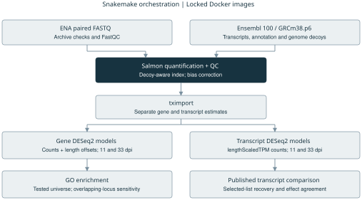
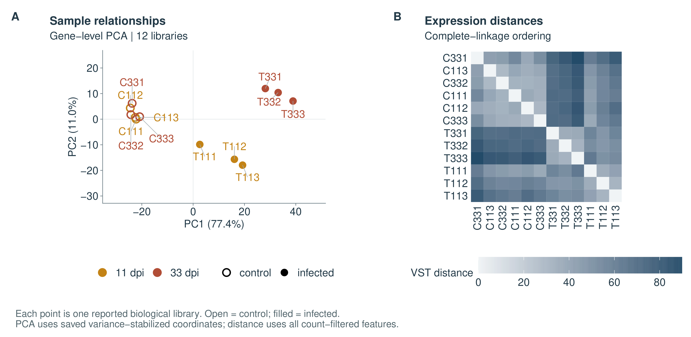
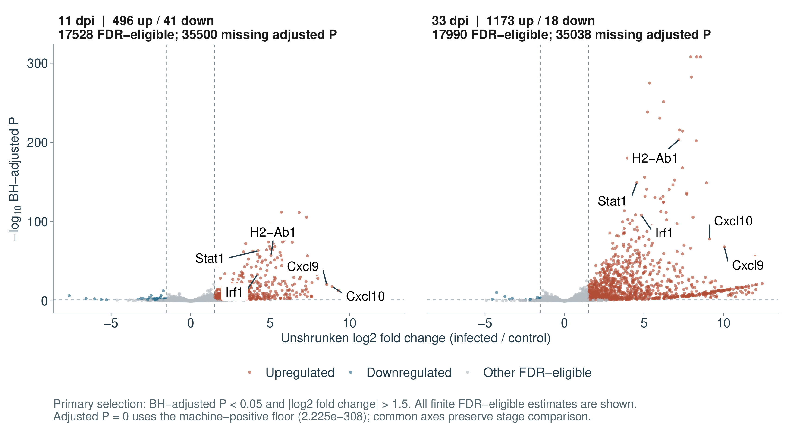
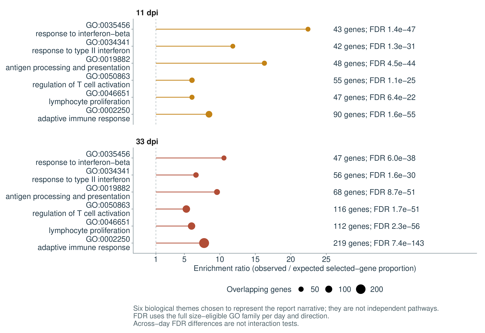
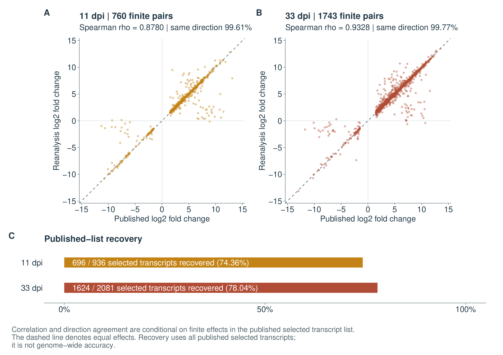

# RNA-seq reanalysis of Toxoplasma-infected mouse brain

M2 workflow project based on Hu et al. (2020) | PRJNA483261

**Zilong Wang** | Université Paris-Saclay, Master 2 Bioinformatics & Biostatistics

[GitHub: zilongwang0826-ops](https://github.com/zilongwang0826-ops) | Project period: October 2026

## Abstract

This M2 workflow project reanalyses 12 public mouse-brain RNA-seq libraries and compares the results with Hu et al. (2020). Three infected libraries are compared with three controls at each of 11 and 33 days after infection. Using BH-adjusted P < 0.05 and absolute unshrunken log2 fold change > 1.5, the analysis identifies 537 and 1,191 differential genes. It recovers 696 of 936 and 1,624 of 2,081 published selected transcripts. Immune-related GO terms are enriched at both time points, but some individual terms change when two overlapping annotation records are counted together. These results describe expression in whole-brain tissue.

## 1. Project aim

Hu and colleagues measured mouse-brain expression during acute and chronic infection with Toxoplasma gondii oocysts [1]. This project asks how closely a reanalysis of their public data recovers the published transcript lists, and where the results differ.

I built a Snakemake workflow for the reanalysis, ran it on a virtual machine and compared its results with the original paper. It combines sample and read-quality checks, Salmon quantification and DESeq2 analysis. Because the paper reports transcript lists, the direct comparison uses transcript IDs and effect estimates; a separate gene-level analysis is used for GO enrichment. A focused annotation check examines the effect of counting two overlapping Ensembl records as one locus.

## 2. Materials and methods

### Study design and inputs

The archive contains 12 distinct runs and BioSamples from female BALB/c mouse brain. There are three reported biological libraries in each condition/time group. Different animals were sampled at the two time points; replicate numbers do not define paired observations. The article describes biological replicates but also mentions pooling in library preparation. The library is therefore the observed unit, while one-mouse-to-one-library independence remains an unresolved assumption.

| Time after infection | Control libraries | Infected libraries | Primary contrast |
|---|---|---|---|
| 11 days | C111, C112, C113 | T111, T112, T113 | Infected versus control |
| 33 days | C331, C332, C333 | T331, T332, T333 | Infected versus control |

The 24 compressed FASTQ files contain 409,862,759 paired fragments and total 65.493 GiB. For every library, the archived read count matches the publication's clean-read count. Additional trimming was disabled. ENA URLs, archive MD5 values and source metadata are retained in the sample manifest.

**Workflow overview.** The workflow uses Docker environments and separates gene-level enrichment from transcript-level comparison with the paper. FastQC and Salmon summaries feed MultiQC; both analysis branches produce result tables and figures.

### Quantification and inference

Salmon 1.10.3 [2] used selective alignment, sequence/GC bias correction and a sparse decoy-aware index with k = 31. The reference combines Ensembl release 100 cDNA and ncRNA with GRCm38.p6 primary-assembly decoys and comprehensive same-release annotation. Library orientation was inferred automatically and checked across samples.

Two separate tracks use tximport [3] and DESeq2 [4]. The gene track imports estimated counts with sample-specific transcript-length offsets. The transcript track uses lengthScaledTPM abundance-derived counts; TPM itself is not supplied as raw counts. For each six-library comparison, features require at least 10 counts in at least three libraries. Models use an intercept and infection condition. Positive log2 fold change indicates higher expression in infected brain.

Primary selection combines a two-sided zero-effect Wald test with BH-adjusted P < 0.05 and absolute unshrunken log2 fold change > 1.5. This effect filter is not a formal test that the effect exceeds 1.5. BH adjustment is separate for each time point and feature level. A nominal-P sensitivity and an exploratory time-by-infection interaction are retained separately.

### Functional analysis and publication comparison

Gene-level GO over-representation uses the tested, annotated gene universe, 10-500-gene term-size limits and a one-sided hypergeometric test. Zero-overlap eligible terms remain in the BH family across BP, CC and MF within each time/direction group. Annotation packages and the full analysis snapshot are versioned. Published transcript lists are matched by Ensembl transcript ID; terminal numeric versions are removed with collision checks. Unlisted published transcripts are not known negatives, so recovery and effect correlations are conditional on the published selection.

## 3. Sample quality and structure

Transformed gene expression separates controls from infected samples, with a further difference between the infected time points. Host-transcript assignment ranged from 73.46% to 88.44%. FastQC base-quality, N-content and adapter modules passed for both mates of every library, and Salmon inferred the same unstranded paired orientation, IU. Processed-pair counts agree with the sample manifest. Checksums cover all 24 FASTQ files; composition, GC and duplication flags are retained in the diagnostic results.

The reconstructed reference contains 141,450 transcript targets, 53,028 gene identifiers and 66 primary-assembly decoys. Comprehensive annotation represents alternative-region targets in the selected FASTA files and supports the transcript-identity comparison.

**Figure 1. Gene-level sample structure.** (A) PCA of variance-stabilized expression from up to 500 variable genes; PC1 and PC2 explain 77.4% and 11.0% of variation. Color denotes time point, with open symbols for controls and filled symbols for infected samples. (B) Euclidean distances across all count-filtered features, ordered by complete-linkage clustering.

T331 has the lowest host assignment and remains near the other day-33 infected libraries in transformed-expression distances. T111 shows a weaker acute response. Both remain in the declared analysis, with their sample-level and saved-model diagnostics retained alongside the results.

## 4. Differential expression

The two gene comparisons identify 537 and 1,191 primary hits at 11 and 33 days, with upregulated features dominating at both times. Transcript-level analyses produce 854 and 1,905 hits and provide the corresponding unit for comparison with the publication.

| Unit / day | Count-filter pass | FDR-eligible | Up | Down | Total hits |
|---|---:|---:|---:|---:|---:|
| Gene / 11 | 17,541 | 17,528 | 496 | 41 | 537 |
| Gene / 33 | 18,024 | 17,990 | 1,173 | 18 | 1,191 |
| Transcript / 11 | 46,242 | 46,173 | 724 | 130 | 854 |
| Transcript / 33 | 47,529 | 47,404 | 1,804 | 101 | 1,905 |

**Figure 2. Gene-level differential expression.** Common axes allow comparison of the two time points. Rust and blue mark selected upregulated and downregulated genes; gray marks other FDR-eligible genes. The labeled genes are discussed below. Missing adjusted P values are counted above each panel, not treated as nonsignificant observations; zero values use the plotting floor stated in the figure.

There are 453 shared upregulated and two shared downregulated genes across days. Stat1, Irf1, Cxcl9, Cxcl10 and H2-Ab1 are upregulated at both time points, connecting the gene-level results with immune-response interpretation. Variation in infection effects across time is evaluated in the separately labeled interaction analysis, which yields 521 gene and 763 transcript tests with adjusted P < 0.05. Time-specific contrasts remain the basis of the primary published-list comparison.

## 5. GO enrichment and annotation sensitivity

Interferon response, antigen processing/presentation, T-cell activation and lymphocyte proliferation are enriched at both time points. The GO-eligible universe contains 15,619 genes at day 11 and 15,976 at day 33. Of the 496 and 1,173 upregulated genes, 447 and 1,028 map to GO; unmapped genes remain reported. There are 929 and 1,129 significant upward GO terms and no significant downward terms under this specification. The paper's downward GO categories are not recovered. Related parent and child terms are not independent findings.

Two overlapping Ensembl records at Lilrb4a/Gm49339 share 467 frozen GO annotations. Collapsing this pair for counting, while retaining the original DE estimates, yields 929 significant upward terms at day 11 with one gained and one lost. At day 33, 1,116 terms remain significant compared with 1,129 in the primary calculation: eleven terms leave the minimum-size family and two retained terms no longer meet the significance criterion. This counting choice affects some individual GO calls, while the six selected immune-related terms remain enriched.

**Figure 3. Six selected GO terms among upregulated genes.** Point area shows gene overlap; horizontal position shows observed/expected selected-gene proportion. Labels give overlap counts and BH-adjusted P. These illustrative terms are shown at both time points; full rankings and downward results are available in the supplementary figures.

At day 33, the adaptive immune response term contains 219 selected genes and has adjusted P = 7.43e-143. Response-to-virus annotations refer to shared host-response genes; they are not evidence of viral infection.

## 6. Comparison with the original study

All published transcript IDs occur in the reconstructed reference. The reanalysis selects 854 transcripts at day 11 and 1,905 at day 33, recovering 74.36% and 78.04% of the paper's selected lists. The corresponding Jaccard indices are 0.6362 and 0.6876; these also account for transcripts selected only in the reanalysis. Most finite matched effects have the same direction (Figure 4).

The publication reports 618 shared upward and six shared downward transcripts across days, compared with 587 and two here. Differences in reference scope, quantification, count import and filtering may contribute to the mismatched lists; the available historical methods do not establish the cause of each discrepancy.

**Figure 4. Agreement with the paper's selected transcript lists.** (A, B) Matched log2 fold changes for transcripts with finite estimates. (C) Recovery uses all 936 and 2,081 published selected transcripts; correlations use only the finite pairs.

## 7. Discussion

Batch and cage assignments are unavailable, Salmon quantification uncertainty was not propagated into the statistical tests, and BALB/c versus reference-strain differences may affect inference. Whole-brain expression also combines cell populations: lymphocyte-associated changes may reflect infiltration, regulation within cells or both. These data cannot distinguish those explanations.

The practical outcome is a working RNA-seq workflow and a quantitative comparison with the original study, including the results that could not be reproduced exactly. The supplementary information records the available files, execution history and remaining gaps in the original methods.

## References

1. Hu R-S, He J-J, Elsheikha HM, et al. Transcriptomic Profiling of Mouse Brain During Acute and Chronic Infections by Toxoplasma gondii Oocysts. *Frontiers in Microbiology*. 2020;11:570903. [doi:10.3389/fmicb.2020.570903](https://doi.org/10.3389/fmicb.2020.570903).

2. Patro R, Duggal G, Love MI, Irizarry RA, Kingsford C. Salmon provides fast and bias-aware quantification of transcript expression. *Nature Methods*. 2017;14:417-419. [doi:10.1038/nmeth.4197](https://doi.org/10.1038/nmeth.4197).

3. Soneson C, Love MI, Robinson MD. Differential analyses for RNA-seq: transcript-level estimates improve gene-level inferences. *F1000Research*. 2015;4:1521. [doi:10.12688/f1000research.7563.2](https://doi.org/10.12688/f1000research.7563.2).

4. Love MI, Huber W, Anders S. Moderated estimation of fold change and dispersion for RNA-seq data with DESeq2. *Genome Biology*. 2014;15:550. [doi:10.1186/s13059-014-0550-8](https://doi.org/10.1186/s13059-014-0550-8).
